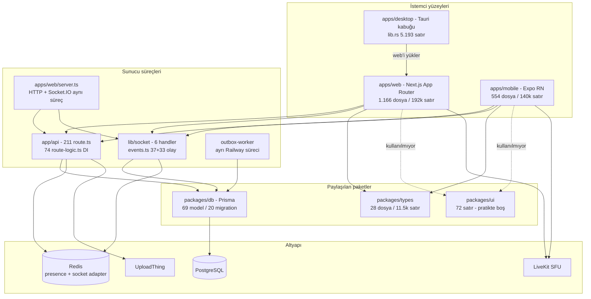

# A1 — Mimari denetimi

Temel commit: `5a2b3990733b17672cf65fba631b7ec44a7bf96a` (`uat`, 2026-08-07)
Tarih: 2026-08-08 · Kanonik veri: [`A1.findings.json`](A1.findings.json)

## Kapsam ve yöntem

Statik analiz `git worktree --detach 5a2b3990` ile kurulan temel ağaçta yapıldı; çalışma ağacındaki ~230 dosyalık paralel iş hiçbir bulguya karışmadı. Dinamik ölçüm bu eksende gerekmedi (tamamı `treeState: "baseline"`).

Taranan sekiz yüzeyin sekizi de hedef kapsamda kapatıldı: `packages/types` (28 dosya), `apps/web/src/lib` (52 klasör), 211 API rotası, `apps/mobile/src` (37 klasör), `src-tauri` (5 dosya), 69 Prisma modeli, `packages/ui` (8 dosya), yapı yapılandırması (3 dosya).

Taranmayan: rota dosyalarının iş mantığı (A3/A4'e ait), çalışma zamanı davranışı (grafik AST tabanlı, socket akışını bilmez).

### `00 §4.2` düzeltmesi — kirli ağaç tuzağı çalıştı

Prompt paketindeki ölçek sayıları çalışma ağacında ölçülmüştü ve temel commit'te farklı çıktı. Düzeltilmiş değerler:

| Ölçüt                        | `00 §4.2` (kirli ağaç) | Temel commit | Fark                     |
| ---------------------------- | ---------------------- | ------------ | ------------------------ |
| API rotası                   | 228                    | **211**      | +17 rota commit'lenmemiş |
| `packages/types/src` dosyası | 33                     | **28**       | +5                       |
| Migration (aktif)            | 22                     | **20**       | +2                       |
| `apps/web/src` satır         | ~204.900               | **192.338**  | +12.562                  |
| `apps/mobile/src` satır      | ~142.600               | **139.546**  | +3.054                   |
| `packages/ui` satır          | 88                     | **72**       | +16                      |
| Web birim testi              | 329                    | **307**      | +22                      |

`A2`–`A6` bu tablodaki temel değerleri kullanmalı.

## Bulgu özeti

critical 0 · high 2 · medium 5 · low 0 — toplam **7**

| id     | Başlık                                                  | Sev    | Güven     | Efor | Dalga |
| ------ | ------------------------------------------------------- | ------ | --------- | ---- | ----- |
| A1-001 | Ölü migration dizini (37) canlı görünüyor               | high   | confirmed | S    | W0    |
| A1-003 | Paylaşılan alan katmanı yok, mantık iki kez yazılıyor   | high   | confirmed | L    | W2    |
| A1-002 | Socket sözleşmesi `apps/web`'de, mobil elle aynalıyor   | medium | confirmed | M    | W2    |
| A1-004 | Modül sınırları araçla zorlanmıyor                      | medium | confirmed | M    | W2    |
| A1-005 | 11 üretim rotası Prisma'yı doğrudan çağırıyor           | medium | confirmed | M    | W1    |
| A1-006 | God node'lar (ses sağlayıcı 2.965 satır / 141 bağlantı) | medium | confirmed | L    | W2    |
| A1-007 | `User` modeli 103 alan                                  | medium | probable  | XL   | W3    |

## En ağır beş bulgu

**A1-001 — Ölü migration dizini.** `packages/db/prisma.config.ts:7` migration yolunu `prisma/rebaseline-migrations`'a sabitliyor, ama Prisma'nın **sözleşmesel varsayılan yeri** olan `packages/db/prisma/migrations/` altında git tarafından izlenen 37 migration dizini (her biri `migration.sql` ile) duruyor. Oraya yazılan migration `prisma migrate deploy` tarafından hiç okunmaz; komut başarılı döner, uyarı çıkmaz, kolon oluşmaz. UAT/prod veritabanına dışarıdan bağlanılamadığı için hata ancak deployment sonrası, kolonu okuyan sorgu patladığında görünür. Tek ayırt edici sinyal `migration_lock.toml`'un ölü dizinde **bulunmaması** — yani eksik bir dosya, görünür bir uyarı değil. Düzeltme S: ölü dizini sil (geçmiş git'te duruyor).

**A1-003 — Paylaşılan katman yok.** `packages/ui` toplam 72 satır. `apps/web/src/lib/voice/video-layout.ts` (95 satır) ve `apps/mobile/src/voice/mobile-video-layout.ts` (96 satır) **aynı dört fonksiyonu** ayrı ayrı tanımlıyor: `resolveMirror`, `resolveVideoAspect`, `resolveVideoFit`, `resolveVideoSizeClass`. Aynı desen link/mention ayrıştırıcısında da var — `apps/web/src/lib/dm/shared-media.ts:25` iki tarafın elle senkron tutulması gerektiğini kendi yorumunda yazıyor. Biri güncellenir, diğeri derlenmeye devam eder: platformlar arası ayrışmanın yapısal kaynağı bu.

**A1-002 — Socket sözleşmesi tek istemcinin içinde.** Tel sözleşmesi `apps/web/src/lib/socket/events.ts:178` (`ServerToClientEvents`, 37 olay). `packages/types/src/socket.ts` yalnız DM DTO'larını taşıyor. Mobil, `MOBILE_REALTIME_SERVER_EVENTS` adlı 35 elemanlı **düz string dizisiyle** aynı sözleşmeyi elle yeniden yazıyor. Bugün iki liste örtüşüyor (fark yalnız `error` ve `dm:error`) — aktif kusur yok, ama koruma da yok: `comm` farkını kontrol eden bir test aranmış, bulunamamış.

**A1-005 — Rota katmanı ikiye bölünmüş.** 74 `route-logic.ts` DI desenini kullanırken 11 üretim rotası Prisma'yı doğrudan çağırıyor — aralarında `mobile/bootstrap` (`route.ts:33`), `users/[userId]/profile` (`route.ts:19`), kullanıcı ayarları ve kanal okundu uçları var. Web birim testlerinde veritabanı olmadığı için bu mantık test edilemez; en sıcak uçlar kapının dışında kalıyor.

**A1-006 — God node'lar.** `live-voice-provider.tsx` 2.965 satır, graphify derecesi **141**; `settings-panel.tsx` 2.654; mobilde `voice-screen.tsx` (2.365) + `use-mobile-voice-room.ts` (2.036). Bağlantı yaşam döngüsü, izin, yayın, abonelik, kalite ve olay köprüsü tek dosyada. Sadece uzun olan veri dosyaları (`mobile-copy.ts` 4.599, lisans manifesti 4.268) **bilinçli olarak bulgu dışı** bırakıldı.

## Arandı, ihlal bulunmadı

Bunlar denetlendi ve temiz çıktı — `A2`–`A6` bunları yeniden aramasın:

| Hipotez                                              | Sonuç                                                                                                                                                                                   |
| ---------------------------------------------------- | --------------------------------------------------------------------------------------------------------------------------------------------------------------------------------------- |
| `packages/*` içinden `apps/*`'a ithal                | **Yok.** Tek eşleşme bile çıkmadı.                                                                                                                                                      |
| Web ↔ mobil doğrudan ithal                           | **Yok.** 8 dosyada `apps/...` geçiyor ama tamamı yorum satırı (bkz. A1-003 — asıl kusur bu yorumların varlığı).                                                                         |
| `@wizards/db` istemci bileşenlerine sızıyor          | **Hayır.** 4 dosya `import type`, 1 dosya (`settings-panel.tsx:46`) bilinçli `@wizards/db/browser` alt export'unu kullanıyor. Paket zaten istemci-güvenli yüzeyi ayırmış.               |
| Socket.IO tek örnek varsayımı                        | **Hayır.** `apps/web/src/lib/socket/redis-adapter.ts` `@socket.io/redis-adapter` ile kurulu, `socket/server.ts:23` ve `worker-runtime.ts:5` üzerinden bağlı. Yatay ölçek destekleniyor. |
| `turbo.json` `typecheck` `db:generate`'e bağlı değil | **Sorun değil.** `dependsOn: ["^typecheck"]` üzerinden `@wizards/db`'nin kendi `typecheck`'i `pnpm db:generate` çalıştırıyor; zincir kapalı.                                            |
| `tsconfig.base.json` path alias uyuşmazlığı          | **Yok.** Dosya yalnız derleyici bayrakları taşıyor, alias tanımı yok.                                                                                                                   |

## Bağımlılık yönü tablosu

| Kaynak         | Hedef                                                  | Durum                                                   |
| -------------- | ------------------------------------------------------ | ------------------------------------------------------- |
| `apps/web`     | `packages/types`, `packages/db`, `packages/ui`         | doğru yön                                               |
| `apps/mobile`  | `packages/types`                                       | doğru yön (`@wizards/db` hiç kullanılmıyor — 0 eşleşme) |
| `apps/desktop` | `apps/web` (çalışma zamanı, Tauri kabuğu web'i yükler) | doğru; kaynak düzeyinde ithal yok                       |
| `packages/*`   | `apps/*`                                               | **ihlal yok**                                           |
| `apps/web`     | `apps/mobile`                                          | yalnız yorum referansı (5 dosya)                        |
| `apps/mobile`  | `apps/web`                                             | yalnız yorum referansı (5 dosya)                        |

Zorlama mekanizması: **yok** (A1-004). Tek istisna `@wizards/db`'nin `./browser` alt export'u.

## God node tablosu

| Dosya                                                          | Satır | Derece    | Sorumluluk                                            | Bulgu           |
| -------------------------------------------------------------- | ----- | --------- | ----------------------------------------------------- | --------------- |
| `apps/web/src/components/providers/live-voice-provider.tsx`    | 2.965 | 141       | bağlantı, izin, yayın, abonelik, kalite, olay köprüsü | A1-006          |
| `apps/web/src/components/settings/settings-panel.tsx`          | 2.654 | ölçülmedi | tüm ayar bölümleri tek dosyada                        | A1-006          |
| `apps/mobile/src/app/screens/voice-screen.tsx`                 | 2.365 | ölçülmedi | ekran + sahne + kontroller                            | A1-006          |
| `apps/mobile/src/voice/use-mobile-voice-room.ts`               | 2.036 | ölçülmedi | mobil ses odası tüm yaşam döngüsü                     | A1-006          |
| `apps/web/src/components/shell/channel-sidebar.tsx`            | 1.933 | ölçülmedi | kanal listesi + kategori + sürükleme                  | izlenecek       |
| `apps/mobile/src/locale/mobile-copy.ts`                        | 4.599 | —         | tek sorumluluk (metin verisi)                         | **bulgu değil** |
| `apps/mobile/src/legal/mobile-open-source-license-manifest.ts` | 4.268 | —         | tek sorumluluk (üretilmiş veri)                       | **bulgu değil** |

## Çapraz platform ayrışma tablosu

| Kavram                    | Web                                                         | Mobil                                                                 | Durum                                     |
| ------------------------- | ----------------------------------------------------------- | --------------------------------------------------------------------- | ----------------------------------------- |
| Video yerleşim kuralı     | `apps/web/src/lib/voice/video-layout.ts:85`                 | `apps/mobile/src/voice/mobile-video-layout.ts:86`                     | **kopya** — 4 aynı fonksiyon, 95/96 satır |
| Video abonelik kuralı     | `apps/web/src/lib/voice/video-subscription.ts` (112)        | `apps/mobile/src/voice/mobile-video-subscription.ts` (145)            | paralel, yorum ile bağlanmış              |
| Link/mention ayrıştırma   | `apps/web/src/lib/dm/shared-media.ts:25`                    | `apps/mobile/src/app/mobile-mention.ts:4`                             | elle senkron ("Both sides must")          |
| Push yükü sözleşmesi      | `apps/web/src/lib/mobile/push-sender.ts`                    | `apps/mobile/src/notifications/mobile-push-display-contract.ts:2`     | elle senkron                              |
| Rozet çipleri             | `apps/web/src/components/shared/profile-badge-chips.tsx:37` | `apps/mobile/src/social/profile-badges/profile-badge-chips.styles.ts` | elle senkron                              |
| Socket olay listesi       | `apps/web/src/lib/socket/events.ts:178` (37)                | `apps/mobile/src/realtime/mobile-realtime-contract.ts:1` (35)         | elle ayna, test yok (A1-002)              |
| Moderasyon toolbar kapısı | `canModerate`                                               | `apps/mobile/src/app/components/message-action-menu.tsx:82`           | elle ayna                                 |

## Mimari şema



Kesikli çizgiler A1-003'ün özeti: paylaşılan UI/alan katmanı var ama boş.

## Ölçümler

| Metrik                                | Değer       | Komut                                                              | Ağaç     |
| ------------------------------------- | ----------- | ------------------------------------------------------------------ | -------- |
| API rotası                            | 211         | `find apps/web/src/app/api -name route.ts \| wc -l`                | baseline |
| `route-logic.ts`                      | 74          | `find … -name 'route-logic.ts' \| wc -l`                           | baseline |
| Doğrudan Prisma çağıran üretim rotası | 11          | `grep -rl 'prisma\.' … --include=route.ts \| grep -v '/e2e/'`      | baseline |
| Ölü migration dizini                  | 37          | `ls -1 packages/db/prisma/migrations/ \| wc -l`                    | baseline |
| Aktif migration                       | 20          | `ls -1 packages/db/prisma/rebaseline-migrations/`                  | baseline |
| `packages/ui` satır                   | 72          | `find packages/ui -name '*.ts*' -exec cat {} + \| wc -l`           | baseline |
| `User` alan sayısı                    | 103         | `awk '/^model User \{/,/^\}/' … \| grep -cE '^\s+\w+\s+\w'`        | baseline |
| `ServerToClientEvents`                | 37          | `sed -n '178,350p' events.ts \| grep -cE '^  "?[a-zA-Z:]+"?: *\('` | baseline |
| `ClientToServerEvents`                | 33          | `sed -n '103,177p' events.ts \| grep -cE …`                        | baseline |
| Mobil aynalanan olay                  | 35          | `MOBILE_REALTIME_SERVER_EVENTS`, `comm` farkı: `error`, `dm:error` | baseline |
| `"use client"` dosyası                | 173 / 1.166 | `grep -rl '"use client"' apps/web/src \| wc -l`                    | baseline |
| `live-voice-provider.tsx` derecesi    | 141         | `graphify explain "live-voice-provider.tsx"`                       | baseline |

## Kapı sonucu

```
findings 7 sema disi 0
kanit hatasi 0
packages/types/src 28/28
apps/web/src/lib/** ust klasorler 52/52
apps/web/src/app/api/**/route.ts 211/211
apps/mobile/src ust klasorler 37/37
apps/desktop/src-tauri/src 5/5
packages/db + schema.prisma 69/69
packages/ui 8/8
turbo.json, pnpm-workspace.yaml, tsconfig.base.json 3/3
```

Üç kontrolün üçü de geçti; kapsam matrisinin sekiz satırı da dolduruldu.

## Açık sorular

1. Soft delete yalnız üç modelde (`User`, `Message`, `DMMessage`). `DMConversation`/`Channel`/`Server` silindiğinde cascade davranışı ürün açısından doğru mu? Somut başarısızlık senaryosu üretilemediği için bulgu yazılmadı — **A5** sınır değer bölümünde silinmiş kayıt senaryolarıyla sınanmalı.
2. `pnpm typecheck` süresinin ne kadarı `db:generate`? **A2** ölçmeli.
3. Outbox worker ile doğrudan socket yayını arasındaki sıralama garantisi okunmadı (`apps/web/src/lib/outbox/`, 4 dosya). **A6** kapasite modelindeki "bildirim" satırı bunu açacak.
4. `apps/mobile/graphify-out/` altında kök `graphify-out/`'tan ayrı ikinci bir bilgi grafiği duruyor. Kusur olarak doğrulanmadı; depo boyutu açısından gözden geçirilmeli.
