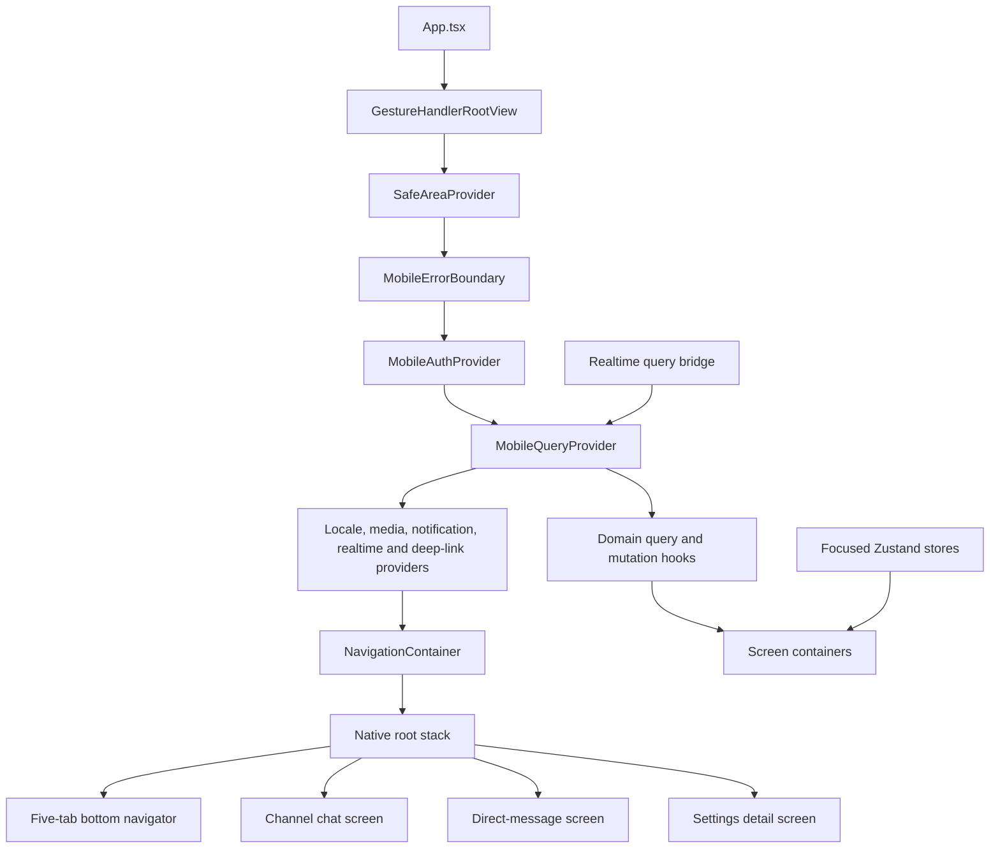

# Whispr Mobile Phase 0 Foundation Modernization Design

**Status:** Approved on 2026-07-09 with the constraints recorded below.

## Objective

Modernize the `apps/mobile` UI foundation without redesigning the product or changing existing user-visible behavior. Phase 0 introduces real navigation, server-state ownership, bounded UI-state stores, realtime-to-query synchronization, and virtualized/cached rendering so later design-system and messaging-parity phases can be implemented without extending `whispr-mobile-root.tsx`.

## Verified Baseline

- Expo SDK 56, React Native 0.85.3, and React 19.2.3 are already in use.
- `src/app/whispr-mobile-root.tsx` is 2,018 lines and owns navigation, bootstrap/workspace/DM/message state, realtime, AppState, deep links, typing, notifications, media, locale, and voice orchestration.
- `src/navigation/mobile-navigation.ts` exposes the stable five-tab contract and pure auth/route helpers but is not a navigation runtime.
- Channel and DM message endpoints already support cursor pagination. There is no separate mobile DM-conversation-list endpoint; recent conversations are part of the bootstrap response.
- The realtime contract maps socket events to bounded refresh sources and fixes the debounce interval at `MOBILE_REALTIME_REFRESH_DEBOUNCE_MS = 350`.
- The checkout contains uncommitted Jest component-test, Maestro, Babel, package, lockfile, and quality-gate work. These changes are treated as pre-existing baseline and must be preserved.
- Before Phase 0 changes, the following checks pass:
  - `corepack pnpm --filter @wizards/mobile typecheck`
  - `corepack pnpm --filter @wizards/mobile test` with 252 passing tests
  - `corepack pnpm --filter @wizards/mobile test:components` with 10 passing tests
  - `corepack pnpm --filter @wizards/mobile quality:check` with no blockers

## Binding Constraints

- Preserve all existing behavior, `MobileTabId` values, deep-link parsers, auth contracts, locale behavior, `MobileErrorBoundary`, and Maestro-visible test IDs.
- Do not change `src/auth`, `src/voice`, contract files, `apps/web`, `apps/desktop`, or `packages/*`, except for unavoidable type-only imports. New app-level providers may consume existing auth and voice APIs without editing those modules.
- Do not upgrade Expo SDK.
- Do not add message reactions, replies, threads, dark mode, visual redesign, or other later-phase features.
- Do not persist the React Query cache and do not add offline message storage. Message content must remain memory-only outside the existing server and session contracts.
- Do not place access tokens, refresh tokens, message bodies, email addresses, or other PII in query keys, diagnostics, or logs.
- Every implementation milestone must end with both:
  - `corepack pnpm --filter @wizards/mobile typecheck`
  - `corepack pnpm --filter @wizards/mobile test`
- Final verification must additionally include:
  - `corepack pnpm --filter @wizards/mobile test:components`
  - `corepack pnpm --filter @wizards/mobile quality:check`
  - Evidence that existing `.maestro` test IDs still render
  - A clean `npx expo install --check` result run from `apps/mobile`
- Major implementation milestones are committed separately with short English messages matching repository history.

## Dependency and Native Configuration Policy

Install Expo-managed/native packages from `apps/mobile` with Expo CLI so SDK 56 selects compatible versions:

- `react-native-screens`
- `react-native-gesture-handler`
- `react-native-reanimated`
- `react-native-worklets`
- `@shopify/flash-list`
- `expo-image`

Install JavaScript-only packages through the mobile workspace package manager:

- `@react-navigation/native`
- `@react-navigation/native-stack`
- `@react-navigation/bottom-tabs`
- `@tanstack/react-query` v5
- `zustand`

After installation, run `npx expo install --check` from `apps/mobile`. A non-clean result blocks completion and must be resolved rather than waived.

Expo SDK 56 automatically configures the Reanimated Babel integration through `babel-preset-expo`. Do not add a manual Reanimated or Worklets plugin to `babel.config.js`; preserve the existing Babel configuration unless `npx expo install --check` or a targeted runtime verification proves a configuration gap.

### Android Back-Handling Decision Gate

`MainActivity.kt` currently calls `super.onCreate(null)`. Before changing fragment restoration behavior:

1. Verify the SDK 56 generated activity behavior and the installed `react-native-screens` requirement against the actual checkout.
2. Verify stack push/pop and process/activity recreation behavior with the existing `super.onCreate(null)` path.
3. If this setup is sufficient, do not add `RNScreensFragmentFactory`, do not add a config plugin, and do not patch native activity code.
4. If verification demonstrates a real gap, stop before applying a native activity/config-plugin patch and report the evidence for explicit approval.

Set `android.predictiveBackGestureEnabled` to `false` for the Phase 0 React Navigation migration. Record the following follow-up verbatim in the migration note:

> Faz 0 sonrası predictive back'i yeniden aç ve Android cihazlarda stack pop, root back ve deep-link dönüşlerini doğrula.

Root-level Android back uses the platform/React Navigation default and must not show an exit confirmation.

## Target Architecture

The final `WhisprMobileRoot` contains only font readiness, top-level provider composition, navigation composition, and truly global overlays. It must remain below 300 physical lines.

## Navigation Design

### Route Model

The navigation layer has two typed levels:

- Root native stack:
  - `MainTabs`
  - `ChannelChat` with opaque `serverId` and `channelId`
  - `DirectMessage` with opaque `conversationId`
  - `SettingsDetail` with a bounded settings-section identifier
- Bottom tabs, preserving the current IDs and order:
  - `overview`
  - `messages`
  - `notifications`
  - `voice`
  - `settings`

The current custom floating tab bar becomes the `bottom-tabs` custom `tabBar`. Existing labels, icons, badges, accessibility state, and `mobile-bottom-tab-*` test IDs remain unchanged. Tab presses are handled by React Navigation rather than `mobileNavigationReducer`; the reducer and its pure tests remain as compatibility API.

Channel and DM selection push typed root-stack routes. Closing these screens pops the stack. Settings subsections push `SettingsDetail`. Root back exits or backgrounds according to the platform default; no confirmation is introduced.

### Auth Guard

`resolveMobileRoute` remains the compatibility source for public/protected tab rules:

- `settings` remains available while signed out.
- The other four tabs, channel chat, DM chat, and protected settings details render the existing `AuthGate` while checking or signed out.
- Auth screens are not pushed onto authenticated history, so completing authentication cannot expose auth UI through hardware back.
- Signing out clears session-scoped query data and UI stores before protected content can render.

### Deep Links

Create a pure React Navigation linking module that reuses `parseMobileDeepLink`, `normalizeSafeMobileRoutePath`, `parseMobileChannelsRoutePath`, and `getMobileTabForRoutePath`.

- Trusted `whispr://` and configured web-origin URLs are accepted.
- Unsafe origins, credential-like query parameters, invalid invites, and unsupported routes continue to fail closed.
- Safe route intents map to tabs or typed stack routes.
- Auth-handoff and invite intents remain command flows handled by the deep-link provider; they are not blindly converted into navigation state.
- The linking module covers cold start and foreground URL delivery.

Unit tests must prove legacy path parity, rejection behavior, auth gating, and stack-target generation.

## Server-State Design

### Query Client

Create one in-memory `QueryClient` per mounted application runtime. Default query policy uses bounded retries, explicit stale times, and redacted errors. No persister, AsyncStorage cache, SecureStore query cache, dehydration, or offline mutation queue is added.

The AppState provider updates TanStack Query's `focusManager`. Foreground backfill remains governed by `getMobileRealtimeForegroundBackfillSources` and the existing sync cooldown rules so focus changes cannot create request storms.

### Query Keys

Centralize keys in a pure factory. Keys contain only fixed labels and opaque server/channel/conversation identifiers:

- `mobile/bootstrap`
- `mobile/workspace/{serverId}`
- `mobile/channel-messages/{channelId}`
- `mobile/dm-conversations`
- `mobile/dm-messages/{conversationId}`
- `mobile/message-search/{scope}/{conversationId}/{normalized-filter-fingerprint}`

The DM-conversation hook is a selector/facade over bootstrap data because the permitted server surface has no independent mobile DM-conversation endpoint. It must not invent an endpoint or change `apps/web`/`packages`.

### Domain Hooks

Screens consume focused domain hooks rather than root props:

- Bootstrap and workspace detail use `useQuery`.
- Channel messages and DM messages use `useInfiniteQuery` with existing cursors.
- Message search uses a cursor-aware query hook and is disabled until current validation rules pass.
- Page flatteners deduplicate by message ID and preserve server ordering.
- Query adapters expose the existing screen-state semantics while screens are migrated, then obsolete manual fetch/reducer state is removed.

### Optimistic Sending

Channel and DM send mutations follow the same lifecycle:

1. Validate current session, target ID, content, and attachments.
2. Cancel the target message query.
3. Snapshot the complete affected infinite-query data.
4. Insert one memory-only optimistic message carrying an opaque client ID and current session author fields.
5. On success, replace the optimistic item with the validated server response and deduplicate realtime echoes.
6. On failure, restore the exact snapshot and expose the existing localized error state without logging message content.
7. Invalidate the narrow bootstrap/conversation summaries needed for unread and last-message metadata.

No optimistic token, email address, or unredacted error is stored.

## UI-State Design

Use separate Zustand stores with named exports and readonly public state:

- Navigation/realtime target store: active server, text channel, voice channel, and DM conversation IDs.
- Composer draft store: drafts keyed by opaque channel or conversation ID, with bounded cleanup on sign-out.
- Overlay store: current sheet/overlay identifiers and visibility only.

The visible route remains canonical for screen location. Screen focus synchronizes the realtime-target store; the store must not independently redirect navigation. Stores reset session-scoped values on sign-out and are not persisted.

## Realtime Query Bridge

Create one bridge module that accepts a `QueryClient`, active opaque targets, and `MobileRealtimeEventEnvelope` values.

- Preserve the existing 350 ms debounce grouping via `getMobileRealtimeRefreshTimerSource`.
- Map bootstrap, presence, and notification sources to the bootstrap key.
- Map workspace, channel, and DM sources to the narrow active target key.
- For validated active-channel message payloads, reuse the existing local message-state contract to update cached pages with `setQueryData`.
- Events without a safe payload, including current DM envelopes, use invalidation rather than storing raw socket payloads.
- Typing, voice invite, voice level, and other local-only events remain in focused providers/state and do not trigger unrelated query refreshes.
- Foreground backfill calls the same source-to-query mapping once and respects the existing minimum-gap rules.
- Cleanup cancels all bridge timers and disconnects the socket on background, sign-out, or unmount.

Realtime snapshots continue to redact message payloads and tokens.

## Provider and Screen Boundaries

Create app-level providers/hooks under `src/app/providers` for responsibilities currently owned by the root:

- Query client and AppState/focus integration
- Locale preference lifecycle
- Notification lifecycle
- Media permission/draft lifecycle
- Realtime connection, local event state, and query bridge
- Deep-link command handling
- Voice-room orchestration through the unchanged `useMobileVoiceRoom` API

Each navigation screen consumes the provider/query/store hooks it needs. Presentational components may receive local render props from their immediate screen container, but no root-to-screen data/callback bundle or multi-screen `ActiveScreenProps` equivalent remains.

## Performance Migration

- Replace channel `FlatList`, DM `MessageStream` mapping, DM conversation lists, and workspace channel lists with FlashList.
- Remove the shell-level `ScrollView`; every screen owns its scrolling behavior so virtualized lists are never nested in a same-axis scroll container.
- Preserve pull-to-refresh and scroll-to-latest behavior.
- Use stable keys, memoized rows, bounded viewability callbacks, and flattened deduplicated query pages.
- Replace React Native `Image` with `expo-image` for avatars and message attachment previews. Use memory/disk caching without persisting message JSON.
- Wrap the application in `GestureHandlerRootView`.
- Add one reduced-motion-aware Reanimated micro-animation to active tab state. No broader visual redesign or gesture feature is introduced.

## Error Handling and Security

- Continue parsing all API responses through existing schemas.
- Convert query/mutation failures to bounded localized UI errors.
- Never log request bodies, message text, raw socket payloads, tokens, email addresses, or full URLs containing query data.
- Clear query caches and session-scoped Zustand state during sign-out.
- Keep auth tokens exclusively behind the existing auth/session APIs.
- Query and UI-state data remain memory-only.

## Verification Strategy

Use test-driven migration for each logic module and screen boundary:

- Unit tests:
  - Query-key stability and PII exclusion
  - Infinite-page flattening and deduplication
  - Optimistic insert, server replacement, realtime deduplication, and rollback
  - Realtime source-to-query mapping and debounce cleanup
  - Foreground backfill mapping
  - Linking config and auth guard parity
  - Each Zustand store's update and sign-out reset behavior
- Component tests:
  - Five-tab render and preserved test IDs
  - Signed-out guard versus public settings
  - Channel and DM stack push/pop
  - FlashList-backed empty, loading, ready, refresh, and error states
  - Expo Image avatar and attachment rendering
  - Active-tab animation without changing accessibility state
- Static/contract evidence:
  - `whispr-mobile-root.tsx` is below 300 lines
  - No manual screen fetch/reducer chain remains
  - No root-to-screen prop bundle remains
  - No query persister/offline cache dependency or setup exists
  - All required `.maestro` test IDs are present in rendered component tests or source-backed render evidence
- Native/config evidence:
  - `npx expo install --check` exits successfully with clean output
  - React Navigation Android stack back behavior is verified before any fragment-factory decision
  - Predictive back is disabled for Phase 0 and explicitly tracked for post-Phase-0 re-enablement

## Migration Sequence

1. Install and verify dependencies; add gesture/query provider foundations and native decision tests.
2. Add query keys, cache adapters, and bootstrap query while preserving current screen output.
3. Add typed bottom-tab/native-stack navigation and guarded linking while preserving tab UI/test IDs.
4. Migrate channel, DM, home, notifications, settings, and voice surfaces to focused hooks/providers.
5. Add the realtime query bridge and foreground backfill integration.
6. Migrate message/channel/DM lists to FlashList and avatar/attachment images to Expo Image; add the tab micro-animation.
7. Remove obsolete root state, refresh callback chains, shell scrolling, and compatibility adapters once unused.
8. Complete final verification, Graphify update, and migration documentation.

Every sequence item is independently typechecked and contract-tested before its commit.

## Migration Note Deliverable

Create `apps/mobile/MIGRATION_PHASE_0.md` containing:

- Final provider/navigation/query/store architecture
- Screen-to-hook/store mapping
- Query-key and realtime invalidation table
- Sign-out/cache-reset behavior
- Explicit statement that query persistence/offline cache is not enabled
- Maestro testID compatibility evidence
- `npx expo install --check` result
- Known limitations and handoff points for the design-system and P0 messaging-parity phases
- The required predictive-back follow-up:

> Faz 0 sonrası predictive back'i yeniden aç ve Android cihazlarda stack pop, root back ve deep-link dönüşlerini doğrula.

## Definition of Done

- Five stable tabs and channel/DM/settings-detail stack screens run under React Navigation.
- Android stack back pops correctly; root back uses the platform default without confirmation.
- Deep links preserve existing `whispr://`, trusted universal-path, rejection, invite, and auth-handoff behavior.
- Protected routes preserve `resolveMobileRoute` auth semantics.
- Bootstrap, workspace, channel messages, DM conversations, DM messages, and search are exposed through React Query hooks.
- Channel and DM messages use cursor-aware infinite queries.
- Channel and DM sends are optimistic, replace on success, and exactly roll back on failure.
- Realtime and foreground events update or invalidate query data through the single bridge; manual refresh callback chains are removed.
- Focused, non-persisted Zustand stores own active targets, drafts, and overlay visibility.
- `whispr-mobile-root.tsx` is below 300 lines and no screen data is delivered through root props drilling.
- All message lists and channel/DM lists in scope use FlashList.
- Avatar and message-attachment images use Expo Image.
- Reanimated/Gesture Handler setup follows verified SDK 56 behavior without an unnecessary manual Babel plugin.
- Fragment-factory behavior is verified before any native activity change; no config plugin/native patch is made when `super.onCreate(null)` is sufficient.
- Predictive back is temporarily disabled and its required post-Phase-0 verification is recorded.
- `npx expo install --check` is clean and its output is reported.
- Every milestone's typecheck and contract tests pass.
- Final component tests and quality check pass.
- Maestro testID render evidence is reported.
- `apps/mobile/MIGRATION_PHASE_0.md` is complete.
- No query persistence, offline message cache, token cache, PII query key, or sensitive log is introduced.
